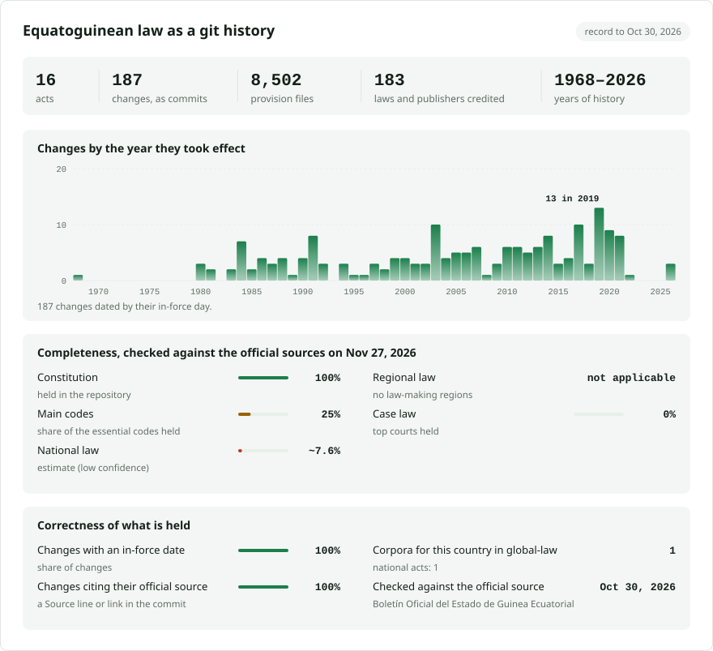

# Equatorial Guinea: law history in git

[Español](README.md) · **English**

<picture>
<source media="(prefers-color-scheme: dark)" srcset="data/effort-dark.svg">

</picture>

The national law of Equatorial Guinea as a git history: one file per article, one commit per version on the day it took effect, and the law that made each version as the commit's author. `git blame` names the law behind every paragraph; `git log` lists every change to an article; picking a date gives the text in force that day, as far as the record reaches.

Part of [lexifina/global-law](https://github.com/lexifina/global-law), one git history for every country's law: this is Equatorial Guinea's national law, which global-law reads at `equatorial-guinea/national/acts/`.

**What is in it now:** 59 acts: the Ley Fundamental (2012), the Spanish Código Civil as in force at independence (1968), and 22 leyes, 12 decretos-leyes, 18 decretos, 1 ordenes, from 1980 to 2011, mostly as enacted, plus 3 OHADA Uniform Acts (`ohada/`). Details in [`STRUCTURE.md`](STRUCTURE.md) and each folder's `README.md`.

Each act is a folder (`constitucion/`, `codigos/codigo-civil/`, `leyes/<year>/<number>-<subject>/`, `decretos/<year>/...`) with one file per article, preamble and provision: `leyes/2021/4-general-de-trabajo/art-083.md` is art. 83 (Vacaciones) of the Ley General de Trabajo. The Ley Fundamental's titles and chapters are in `constitucion/estructura.md`; each folder's `README.md` lists its provisions.

The text is in Spanish, as the Boletín Oficial del Estado prints it. An English translation is not part of this record.

## Questions as git commands

| Question | Command |
| --- | --- |
| Every change to art. 83 of the Ley General de Trabajo | `git log -p --word-diff --follow -- leyes/2021/4-general-de-trabajo/art-083.md` |
| Which law wrote each line of art. 83? | `git blame leyes/2021/4-general-de-trabajo/art-083.md` |
| Every version of the Ley General de Trabajo, with the day each took effect | `git log --format="%h %(trailers:key=In-force,valueonly,separator=) %an" --grep="^In-force:" --follow -- leyes/2021/4-general-de-trabajo/art-083.md` |
| Art. 1902 of the Código Civil as in force on 1 January 2025 | `python tools/en_vigor_el.py 2025-01-01 codigos/codigo-civil/libro-4 art-1902` |

**Outside git**, we also host this record publicly, for free:

- **[Ask Claude about the law of Equatorial Guinea](https://global-law.lexifina.com/v1/try_claude?country=equatorial-guinea)**: opens Claude with a first question ready.
- **[Ask ChatGPT](https://global-law.lexifina.com/v1/try_chatgpt?country=equatorial-guinea)**: the same question in ChatGPT.
- **[Search the law of Equatorial Guinea on our site](https://lexifina.com/law?country=equatorial-guinea&q=vacaciones)**: a search for "vacaciones", with each provision's text and its versions, no account needed.
- **[Developer REST API](https://global-law.lexifina.com/v1/search_law?query=vacaciones&jurisdiction=equatorial-guinea)**: the same search as JSON, with no key. See the [documentation here](https://lexifina.com/api/global-law).

Both assistants read the record through the free Global law connector (MCP, `https://global-law.lexifina.com/mcp`); the first time, the chat gives you the link that adds it. Ask in Spanish or in English.

**Host it yourself easily.** All it takes is git and Python, and the tools run on your machine:

```sh
git clone --depth 1 https://github.com/lexifina/global-law && cd global-law
python3 tools/countries.py add equatorial-guinea/national/acts
python3 tools/law.py show 2026-01-01 equatorial-guinea/national/acts/codigos/codigo-civil/libro-4/art-1902.md
```

Opened in Claude Code, Cursor, VS Code or Codex, the clone also starts a local MCP server with the same tools ([MCP.md](https://github.com/lexifina/global-law/blob/main/MCP.md)).

## Dates

Each commit is dated at noon, Africa/Malabo, on the day the version took effect, and carries it in its `In-force:` trailer:

- the Ley Fundamental took effect on its promulgation after the referendum and its publication in the Boletín Oficial del Estado (its disposición final); it was promulgated in Bata on 16 February 2012, the date under which the BOE lists it, and the BOE gives no separate publication day;
- the Ley General de Trabajo took effect "a los treinta días de su publicación en el Boletín Oficial del Estado"; the BOE's online index does not list the issue, so publication is taken as the date of the BOE's printed edition (Malabo, 31 January 2022), and the thirtieth day after it is 2 March 2022.
- the other acts are dated by their own entry-into-force clause, counted from publication; the BOE's online index gives the date of each act but not the day of its issue, so where no publication day is known the count runs from the date of the act, and an act that says nothing takes effect twenty days after publication (Código Civil, art. 1). Each commit's `In-force-basis:` trailer says which rule was used;
- the Código Civil is the Spanish text as in force on 12 October 1968, the day of independence, from which it continued to apply; its commit carries the real day in its subject and is stamped 1 January 1970, as git cannot hold earlier dates.

Each version is credited to the law that made it (`Ley 1/2012`, `Ley Núm. 4/2021`), at an address that cannot exist, so `git blame` and `git log --author` name laws; the committer is Lexifina.

## How it is checked

- `tools/check_repo.py` reads every version back from git on the day it took effect and on the day before; both must match the corpus: 2 versions of 2 acts, 0 mismatches, and a second build from the same corpus gave identical hashes ([`REPRODUCE.md`](REPRODUCE.md)).
- The Ley Fundamental is read from the PDF's own text layer (not a scan), and every word was compared with a second extraction: they differ only in the headings and title page, which are not in the article files.
- Every paragraph and article heading of the Ley General de Trabajo was found, in order, in a second, independent extraction of its PDF; arts. 1 to 120 are all present.
- History is append-only (`tools/append.py`): no merge commits on `main`, no commit dates that go backwards, nothing dated in the future, and every commit's trailers parse.
- [vulnerabilities/](vulnerabilities/README.en.md): possible drafting mistakes in this law, found by global-law's detectors and checked by hand. Not run yet.

## What it does not show

- **The Ley Fundamental as reformed in 2025.** Ley Nº 1/2025, de 16 de julio, reforms arts. 56.1, 80 and 84.1 and 2; the BOE publishes it only as page images, which are not transcribed, so arts. 56, 80 and 84 here are the 2012 wording.
- **The Ley General de Trabajo as amended.** Ley Núm. 6/2026, de 10 de abril, amends some of its articles; it too is only a scan, and is not applied.
- **Earlier constitutions.** The Ley Fundamental of 1991 and its 1995 reform were not found online with a text layer, so the history starts in 2012.
- **Much national law.** The BOE's online catalogue lists about 1,000 texts (most of them appointments and decorations, which are not included); 290 of its laws and decrees are scans with no usable text layer and are held, as are FAOLEX copies whose scanner text is unreadable. The Código Penal of 2022 (Ley Núm. 4/2022) was found only as a scan; the Código de Comercio and the Ley de Enjuiciamiento Criminal (Spanish codes still applied) are not yet here, as no source gives their 1968 text. 13 acts here come from scanner text layers published with the PDF (`Text-source: publisher OCR`) and may contain misreadings.
- **Headings and page furniture.** Title and chapter headings are not in the article files (the Ley Fundamental's are in `constitucion/estructura.md`); the title page and the electronic-signature line on every page are left out.

## Sources

| Source | Kind | Past versions | Notes |
| --- | --- | --- | --- |
| [Boletín Oficial del Estado](https://boe.gob.gq) (Presidencia del Gobierno) | Official gazette: each law and decree as enacted, one PDF each | no | The Ley Fundamental's text and dates, the list of its reforms, and 39 further laws and decrees; the BOE publishes no consolidation and no amendment notes |
| BOE printed edition of Ley Núm. 4/2021 (Dirección General del B.O.E., Malabo, 31 January 2022), copy held by the [Observatoire des Forêts d'Afrique Centrale (COMIFAC)](https://www.observatoire-comifac.net) | Official edition, born-digital | no | The Ley General de Trabajo as enacted |
| [FAOLEX](https://faolex.fao.org) (FAO) | Secondary copy: Boletín Oficial del Estado PDFs held by FAO, many with a scanner text layer | no | 14 acts not otherwise online; tagged `Source-status: secondary copy (FAOLEX, ...)` |
| [Agencia Estatal Boletín Oficial del Estado (Spain)](https://www.boe.es), consolidated legislation | Official consolidated text with every version of every article | yes | The Código Civil as in force on 12 October 1968 |
| [OHADA](https://www.ohada.org), Journal officiel and official translation | Official OHADA PDFs with a born-digital text layer | yes | 3 Uniform Acts in `ohada/` |

## Licence

See [`LICENSE`](LICENSE). The texts are official legal texts of the Republic of Equatorial Guinea, as published by the Boletín Oficial del Estado, reproduced with that attribution; the BOE states no licence for its files, and their copyright status is not confirmed. Lexifina's own contributions (the arrangement, commit messages, tables and tools) are CC0 1.0.

No AI model wrote, translated or corrected legal text, and none runs at build time; the scripts were written by Claude Code running Claude Opus 5.5 (see [`REPRODUCE.md`](REPRODUCE.md)).

## Visualisations

- [visualisations/](visualisations/README.en.md): charts drawn from this repository. Not drawn yet.

## More

From [lexifina/global-law](https://github.com/lexifina/global-law):

- [FEATURES.md](https://github.com/lexifina/global-law/blob/main/FEATURES.md): every feature, and what every corpus must support (`git blame`, `law.py`, the MCP tools)
- [FAQ.md](https://github.com/lexifina/global-law/blob/main/FAQ.md): questions and answers · [CONTRIBUTING.md](https://github.com/lexifina/global-law/blob/main/CONTRIBUTING.md): proposing changes · [MCP.md](https://github.com/lexifina/global-law/blob/main/MCP.md): the MCP server · [REPRODUCE.md](https://github.com/lexifina/global-law/blob/main/REPRODUCE.md): how it was built · [CHANGELOG.md](https://github.com/lexifina/global-law/blob/main/CHANGELOG.md)
- [FRESHNESS.md](https://github.com/lexifina/global-law/blob/main/FRESHNESS.md): how current each corpus is · [Monitoring](https://github.com/lexifina/global-law/tree/main/monitoring): whether updates are running · [WATCHING.md](https://github.com/lexifina/global-law/blob/main/WATCHING.md): how each official source is watched for changes
- [performance/](https://github.com/lexifina/global-law/tree/main/performance): how fast the tools are, measured
- [visualisations/](https://github.com/lexifina/global-law/tree/main/visualisations): charts and bridges across the world's law
- [Vulnerabilities](https://github.com/lexifina/global-law/tree/main/vulnerabilities): mistakes in legislation as published
