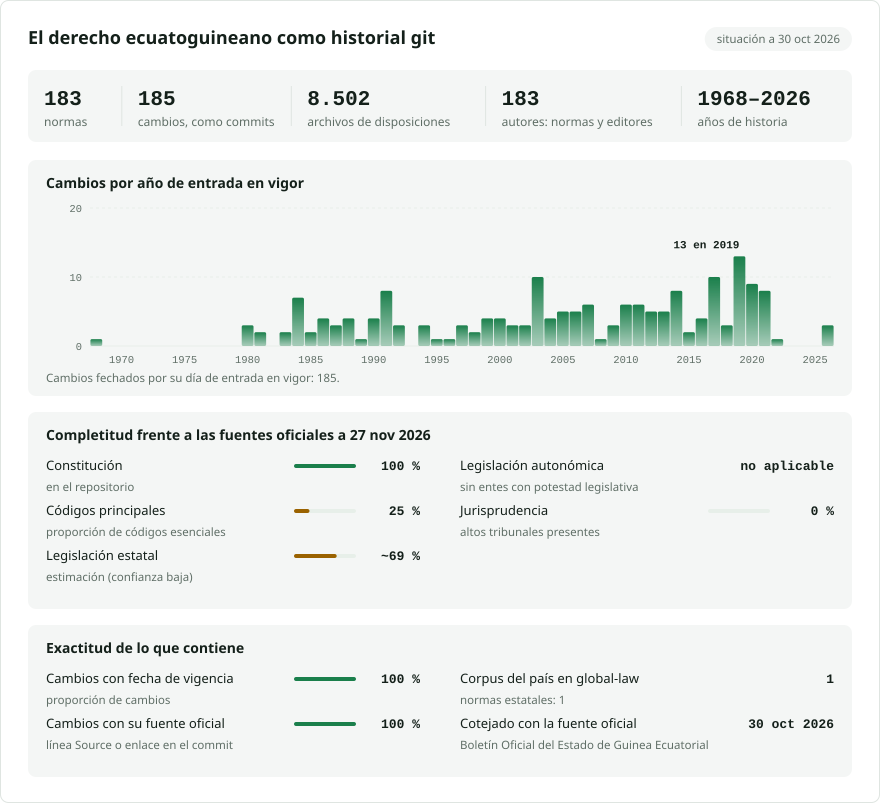

# Guinea Ecuatorial: historia del derecho en git

**Español** · [English](README.en.md)

<picture>
<source media="(prefers-color-scheme: dark)" srcset="data/es/effort-dark.svg">

</picture>

El derecho nacional de Guinea Ecuatorial como historia de git: un archivo por artículo, un commit por versión el día de su entrada en vigor, y la ley que hizo cada versión como autora del commit. `git blame` indica la ley que está detrás de cada párrafo; `git log` enumera todos los cambios de un artículo; al elegir una fecha se obtiene el texto vigente ese día, hasta donde alcanza el registro.

Forma parte de [lexifina/global-law](https://github.com/lexifina/global-law), una única historia de git para el derecho de todos los países: este es el derecho nacional de Guinea Ecuatorial, que global-law lee en `equatorial-guinea/national/acts/`.

**Qué contiene ahora:** 59 normas: la Ley Fundamental (2012), el Código Civil español vigente en la independencia (1968) y 22 leyes, 12 decretos-leyes, 18 decretos, 1 órdenes, de 1980 a 2011, casi todas en su texto promulgado, además de 3 actos uniformes de la OHADA (`ohada/`). Detalle en [`STRUCTURE.md`](STRUCTURE.md) y en el `README.md` de cada carpeta.

Cada norma es una carpeta (`constitucion/`, `codigos/codigo-civil/`, `leyes/<año>/<núm>-<objeto>/`, `decretos/<año>/...`) con un archivo por artículo, preámbulo y disposición: `leyes/2021/4-general-de-trabajo/art-083.md` es el art. 83 (Vacaciones) de la Ley General de Trabajo. Los títulos y capítulos de la Ley Fundamental están en `constitucion/estructura.md`; el `README.md` de cada carpeta enumera sus disposiciones.

El texto está en español, tal como lo publica el Boletín Oficial del Estado. Este registro no incluye una traducción al inglés.

## Preguntas como comandos de git

| Pregunta | Comando |
| --- | --- |
| Todos los cambios del art. 83 de la Ley General de Trabajo | `git log -p --word-diff --follow -- leyes/2021/4-general-de-trabajo/art-083.md` |
| ¿Qué ley escribió cada línea del art. 83? | `git blame leyes/2021/4-general-de-trabajo/art-083.md` |
| Todas las versiones de la Ley General de Trabajo, con el día en que entró en vigor cada una | `git log --format="%h %(trailers:key=In-force,valueonly,separator=) %an" --grep="^In-force:" --follow -- leyes/2021/4-general-de-trabajo/art-083.md` |
| El art. 1902 del Código Civil vigente al 1 de enero de 2025 | `python tools/en_vigor_el.py 2025-01-01 codigos/codigo-civil/libro-4 art-1902` |

**Fuera de git**, también alojamos este registro de forma pública y gratuita:

- **[Preguntar a Claude sobre el derecho ecuatoguineano](https://global-law.lexifina.com/v1/try_claude?country=equatorial-guinea)**: abre Claude con una primera pregunta preparada.
- **[Preguntar a ChatGPT](https://global-law.lexifina.com/v1/try_chatgpt?country=equatorial-guinea)**: la misma pregunta en ChatGPT.
- **[Buscar en el derecho de Guinea Ecuatorial en nuestro sitio](https://lexifina.com/law?country=equatorial-guinea&q=vacaciones)**: una búsqueda de "vacaciones", con el texto de cada disposición y sus versiones, sin necesidad de cuenta.
- **[API REST para desarrolladores](https://global-law.lexifina.com/v1/search_law?query=vacaciones&jurisdiction=equatorial-guinea)**: la misma búsqueda en JSON, sin clave. Consulte la [documentación aquí](https://lexifina.com/api/global-law).

Ambos asistentes leen el registro a través del conector gratuito Global law (MCP, `https://global-law.lexifina.com/mcp`); la primera vez, el chat le da el enlace para añadirlo. Pregunte en español o en inglés.

**Alójelo usted mismo fácilmente.** Solo hacen falta git y Python, y las herramientas se ejecutan en su equipo:

```sh
git clone --depth 1 https://github.com/lexifina/global-law && cd global-law
python3 tools/countries.py add equatorial-guinea/national/acts
python3 tools/law.py show 2026-01-01 equatorial-guinea/national/acts/codigos/codigo-civil/libro-4/art-1902.md
```

Abierto en Claude Code, Cursor, VS Code o Codex, el clon también inicia un servidor MCP local con las mismas herramientas ([MCP.md](https://github.com/lexifina/global-law/blob/main/MCP.md)).

## Fechas

Cada commit está fechado a las doce del mediodía, hora de Africa/Malabo, del día en que la versión entró en vigor, y lleva ese día en su trailer `In-force:`:

- la Ley Fundamental entró en vigor con su promulgación tras el referéndum y su publicación en el Boletín Oficial del Estado (su disposición final); fue promulgada en Bata el 16 de febrero de 2012, fecha con la que la recoge el BOE, y el BOE no da un día de publicación distinto;
- la Ley General de Trabajo entró en vigor "a los treinta días de su publicación en el Boletín Oficial del Estado"; el índice en línea del BOE no recoge el número, por lo que se toma como publicación la fecha de la edición impresa del BOE (Malabo, 31 de enero de 2022), y el trigésimo día posterior es el 2 de marzo de 2022.
- las demás normas se fechan por su propia cláusula de entrada en vigor, contada desde la publicación; el índice en línea del BOE da la fecha de cada norma pero no el día de su número, por lo que, cuando no se conoce el día de publicación, el plazo se cuenta desde la fecha de la norma, y una norma que no dice nada entra en vigor a los veinte días de su publicación (Código Civil, art. 1). El trailer `In-force-basis:` de cada commit indica la regla aplicada;
- el Código Civil es el texto español vigente el 12 de octubre de 1968, día de la independencia, desde el que siguió aplicándose; su commit lleva el día real en el asunto y la fecha del 1 de enero de 1970, ya que git no admite fechas anteriores.

Cada versión se atribuye a la ley que la hizo (`Ley 1/2012`, `Ley Núm. 4/2021`), con una dirección que no puede existir, de modo que `git blame` y `git log --author` indican leyes; el committer es Lexifina.

## Cómo se verifica

- `tools/check_repo.py` vuelve a leer desde git cada versión el día en que entró en vigor y el día anterior; ambas lecturas deben coincidir con el corpus: 2 versiones de 2 normas, 0 discrepancias, y una segunda compilación a partir del mismo corpus dio hashes idénticos ([`REPRODUCE.md`](REPRODUCE.md)).
- La Ley Fundamental se lee de la propia capa de texto del PDF (no de un escaneo), y cada palabra se comparó con una segunda extracción: solo difieren en los encabezados y la portada, que no están en los archivos de los artículos.
- Cada párrafo y cada encabezado de artículo de la Ley General de Trabajo se encontró, en orden, en una segunda extracción independiente de su PDF; están todos los arts. 1 a 120.
- La historia solo admite adiciones (`tools/append.py`): no hay commits de fusión (merge) en `main`, ni fechas de commit que retrocedan, ni nada fechado en el futuro, y los trailers de todos los commits se analizan sin errores.
- [vulnerabilities/](vulnerabilities/): posibles errores de redacción en este derecho, hallados por los detectores de global-law y revisados a mano. Aún no se ha ejecutado.

## Qué no muestra

- **La Ley Fundamental reformada en 2025.** La Ley Nº 1/2025, de 16 de julio, reforma los arts. 56.1, 80 y 84.1 y 2; el BOE solo la publica como imágenes de página, que no se transcriben, por lo que los arts. 56, 80 y 84 tienen aquí la redacción de 2012.
- **La Ley General de Trabajo modificada.** La Ley Núm. 6/2026, de 10 de abril, modifica algunos de sus artículos; también es solo un escaneo y no se aplica.
- **Las constituciones anteriores.** La Ley Fundamental de 1991 y su reforma de 1995 no se encontraron en línea con capa de texto, por lo que la historia comienza en 2012.
- **Buena parte del derecho nacional.** El catálogo en línea del BOE enumera unos 1.000 textos (la mayoría nombramientos y condecoraciones, que no se incluyen); 290 de sus leyes y decretos son escaneos sin capa de texto utilizable y quedan pendientes, igual que las copias de FAOLEX cuyo texto de escáner es ilegible. El Código Penal de 2022 (Ley Núm. 4/2022) solo se encontró escaneado; el Código de Comercio y la Ley de Enjuiciamiento Criminal (códigos españoles aún aplicados) aún no están, porque ninguna fuente da su texto de 1968. 13 normas proceden de capas de texto de escáner publicadas con el PDF (`Text-source: publisher OCR`) y pueden contener errores de lectura.
- **Encabezados y elementos de página.** Los encabezados de títulos y capítulos no están en los archivos de los artículos (los de la Ley Fundamental están en `constitucion/estructura.md`); se omiten la portada y la línea de firma electrónica de cada página.

## Fuentes

| Fuente | Tipo | Versiones anteriores | Notas |
| --- | --- | --- | --- |
| [Boletín Oficial del Estado](https://boe.gob.gq) (Presidencia del Gobierno) | Diario oficial: cada ley y decreto en su texto promulgado, un PDF por norma | no | El texto y las fechas de la Ley Fundamental, la lista de sus reformas y otras 39 leyes y decretos; el BOE no publica textos consolidados ni notas de modificación |
| Edición impresa del BOE de la Ley Núm. 4/2021 (Dirección General del B.O.E., Malabo, 31 de enero de 2022), ejemplar conservado por el [Observatoire des Forêts d'Afrique Centrale (COMIFAC)](https://www.observatoire-comifac.net) | Edición oficial, nativa digital | no | La Ley General de Trabajo en su texto promulgado |
| [FAOLEX](https://faolex.fao.org) (FAO) | Copia secundaria: PDF del Boletín Oficial del Estado conservados por la FAO, muchos con capa de texto de escáner | no | 14 normas que no están en línea de otro modo; marcadas `Source-status: secondary copy (FAOLEX, ...)` |
| [Agencia Estatal Boletín Oficial del Estado (España)](https://www.boe.es), legislación consolidada | Texto consolidado oficial con todas las versiones de cada artículo | sí | El Código Civil vigente el 12 de octubre de 1968 |
| [OHADA](https://www.ohada.org), Journal officiel y traducción oficial | PDF oficiales de la OHADA con capa de texto nativa | sí | 3 actos uniformes en `ohada/` |

## Licencia

Véase [`LICENSE`](LICENSE). Los textos son textos jurídicos oficiales de la República de Guinea Ecuatorial, tal como los publica el Boletín Oficial del Estado, reproducidos con esa atribución; el BOE no indica ninguna licencia para sus archivos, y su situación en materia de derecho de autor no está confirmada. Las contribuciones propias de Lexifina (la organización, los mensajes de commit, las tablas y las herramientas) son CC0 1.0.

Ningún modelo de IA escribió, tradujo ni corrigió texto normativo, y ninguno se ejecuta durante la compilación; los scripts los escribió Claude Code con Claude Opus 5.5 (véase [`REPRODUCE.md`](REPRODUCE.md)).

Esta es una traducción de la versión inglesa ([README.en.md](README.en.md)); si difieren, prevalece la versión inglesa.

## Visualizaciones

- [visualisations/](visualisations/): gráficos hechos a partir de este repositorio. Aún no se han hecho.

## Más información

Del repositorio [lexifina/global-law](https://github.com/lexifina/global-law) (páginas en inglés):

- [FEATURES.md](https://github.com/lexifina/global-law/blob/main/FEATURES.md): todas las funciones y lo que cada corpus debe admitir (`git blame`, `law.py`, herramientas MCP)
- [FAQ.md](https://github.com/lexifina/global-law/blob/main/FAQ.md): preguntas y respuestas · [CONTRIBUTING.md](https://github.com/lexifina/global-law/blob/main/CONTRIBUTING.md): proponer cambios · [MCP.md](https://github.com/lexifina/global-law/blob/main/MCP.md): servidor MCP · [REPRODUCE.md](https://github.com/lexifina/global-law/blob/main/REPRODUCE.md): cómo se ha construido · [CHANGELOG.md](https://github.com/lexifina/global-law/blob/main/CHANGELOG.md)
- [FRESHNESS.md](https://github.com/lexifina/global-law/blob/main/FRESHNESS.md): lo actualizado que está cada corpus · [Supervisión](https://github.com/lexifina/global-law/tree/main/monitoring): si las actualizaciones funcionan · [WATCHING.md](https://github.com/lexifina/global-law/blob/main/WATCHING.md): cómo se vigila cada fuente oficial para detectar cambios
- [performance/](https://github.com/lexifina/global-law/tree/main/performance): la rapidez de las herramientas, medida
- [visualisations/](https://github.com/lexifina/global-law/tree/main/visualisations): gráficos y conexiones a través del derecho de todo el mundo
- [Vulnerabilidades](https://github.com/lexifina/global-law/tree/main/vulnerabilities): errores en las normas tal como se publicaron
